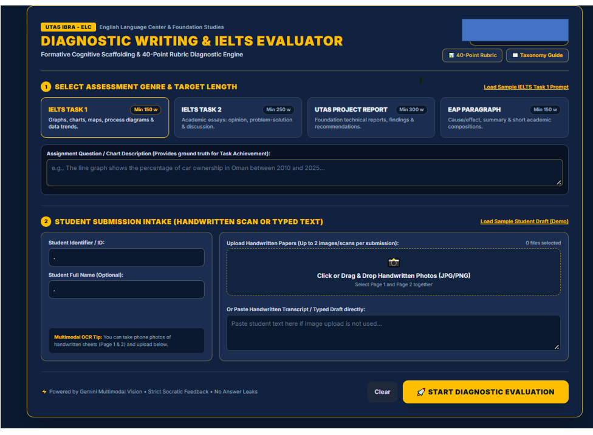
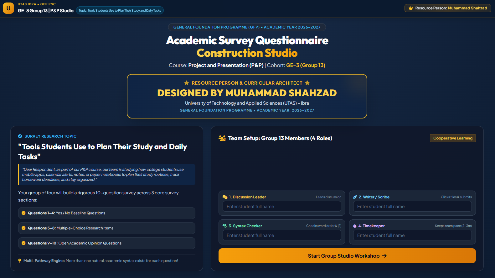
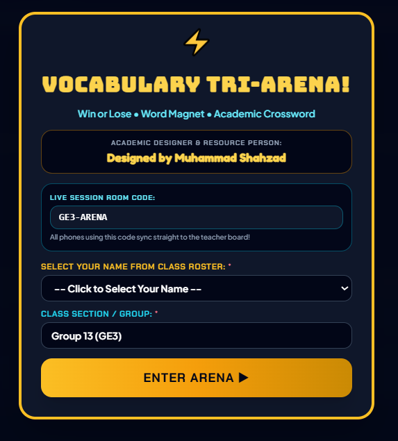
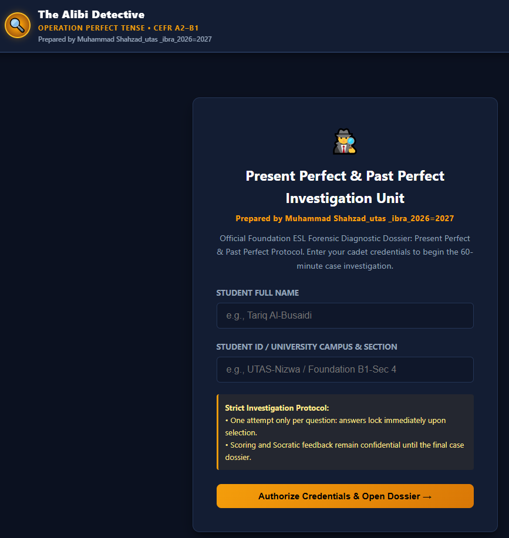
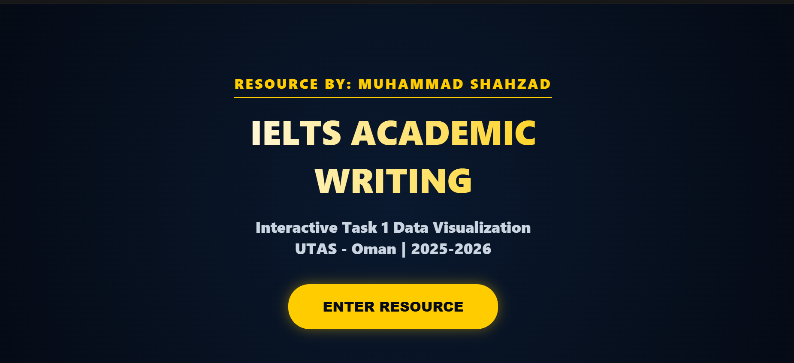

# Interactive & AI-Supported Learning Design

### Muhammad Shahzad
**University English Lecturer | Interactive Learning Designer | AI-Supported Education**

Higher Education | English Language Teaching | Interactive Learning | Gamification | AI-Supported Assessment

---

## About Me

I am a university English language lecturer with over 25 years of teaching experience, currently working in higher education in Oman.

My professional interests focus on the design of interactive, technology-supported learning experiences that address practical challenges in language education.

Drawing on my classroom experience, I develop digital learning activities, gamified exercises, scaffolded writing tasks, interactive presentations, and assessment tools. My work explores how technology and artificial intelligence can support language learning while keeping teachers actively involved in pedagogical decisions.

This portfolio presents selected projects that demonstrate my approach to combining teaching experience, instructional design, and emerging educational technologies.

---

## Featured Projects

The following projects represent my work in interactive learning design, gamification, writing development, and AI-supported assessment.

### 1. AI Diagnostic Writing Evaluator

**AI-Supported Assessment | IELTS/EFL Writing**

A prototype designed to analyse handwritten student writing using multimodal AI. The assessment workflow combines handwritten-response analysis, rubric-based evaluation, error diagnosis, and targeted formative feedback.

**Design focus:** AI-supported assessment, writing diagnosis, formative feedback, and teacher decision-making.

**Technology environment:** Google Gemini. The full AI analysis currently depends on the Gemini environment; the GitHub Pages link provides the project interface rather than an independently functioning AI application.

- [Project Interface](https://shahzad007-crypto.github.io/Marking-assessment/)
- [Source Repository](https://github.com/shahzad007-crypto/Marking-assessment)

*Note: This is a prototype. A privacy-safe demonstration version should be prepared before public professional presentation. Do not use the current interface publicly if it exposes identifiable student or assessment information.*

### 2. Tools Students Use – Survey Construction Studio

**Collaborative Learning | Language Production**

An interactive learning activity in which students work with survey-related language and construct questions through guided tasks. It encourages active participation, structured language production, and collaborative learning.

**Design focus:** Learner engagement, collaborative tasks, guided sentence construction, and activity-based learning.

- [Project Interface](https://shahzad007-crypto.github.io/Tools-students-use-/)
- [Source Repository](https://github.com/shahzad007-crypto/Tools-students-use-)

### 3. Vocabulary Tri-Arena

**Gamified Learning | Vocabulary and Listening**

A multi-stage vocabulary learning activity combining listening, quizzes, sentence construction, and interactive challenges. Game elements encourage participation and provide opportunities for repeated practice.

**Design focus:** Gamification, vocabulary development, listening practice, immediate feedback, and learner engagement.

- [Project Interface](https://shahzad007-crypto.github.io/vocab-6-A-listening-QTT/)
- [Source Repository](https://github.com/shahzad007-crypto/vocab-6-A-listening-QTT)

### 4. Tenses Game – The Alibi Detective

**Gamified Grammar Learning | Interactive Assessment**

A narrative-based grammar activity in which learners work through a sequence of challenges involving English tenses. The detective theme provides a context for grammar practice, feedback, and assessment.

**Design focus:** Game-based learning, grammar practice, staged challenges, and diagnostic feedback.

- [Project Interface](https://shahzad007-crypto.github.io/tenses-gameperfect/)
- [Source Repository](https://github.com/shahzad007-crypto/tenses-gameperfect)

### 5. Sentence-by-Sentence Bar Chart

**Scaffolded Writing | IELTS Academic Writing Task 1**

An interactive writing activity that guides learners through the process of constructing a bar-chart description sentence by sentence. It breaks a demanding writing task into manageable stages.

**Design focus:** Writing scaffolding, academic language, sentence construction, and gradual development of independent writing.

- [Project Interface](https://shahzad007-crypto.github.io/sentence-by-sentence-bar-chart-/)
- [Source Repository](https://github.com/shahzad007-crypto/sentence-by-sentence-bar-chart-)

### 6. IELTS Opinion Essay

**Writing Development | IELTS Academic Writing Task 2**

An interactive learning resource designed to support learners in developing opinion essays through structured guidance and writing practice.

**Design focus:** Essay organisation, argument development, language support, and scaffolded writing.

- [Project Interface](https://shahzad007-crypto.github.io/IELTS-opinion-essay-/)
- [Source Repository](https://github.com/shahzad007-crypto/IELTS-opinion-essay-)

### 7. IELTS Cue Card Speaking

**Speaking Development | Guided Language Production**

An interactive speaking-practice resource built around IELTS cue-card tasks. It supports learners in organising ideas and developing spoken responses through guided practice.

**Design focus:** Speaking fluency, idea development, structured responses, and independent practice.

- [Project Interface](https://shahzad007-crypto.github.io/IELTS-cue-card-speaking-/)
- [Source Repository](https://github.com/shahzad007-crypto/IELTS-cue-card-speaking-)

### 8. Conditionals Gamified

**Gamified Grammar | Formative Assessment**

An interactive grammar activity that uses game-oriented practice to help learners understand and apply English conditional structures.

**Design focus:** Grammar learning, interactive practice, feedback, and learner progress.

- [Project Interface](https://shahzad007-crypto.github.io/conditionals-gamified-/)
- [Source Repository](https://github.com/shahzad007-crypto/conditionals-gamified-)

### 9. Gamified Adjectives – The Alibi Detective

**Vocabulary and Grammar | Narrative-Based Learning**

A detective-themed language activity that uses staged challenges to engage learners in adjective-related practice.

**Design focus:** Gamified language learning, vocabulary development, interactive challenges, and feedback.

- [Project Interface](https://shahzad007-crypto.github.io/gamified-adjectives/)
- [Source Repository](https://github.com/shahzad007-crypto/gamified-adjectives)

### 10. Aeroplane Vocabulary Game

**Gamified Vocabulary | Interactive Practice**

A game-based vocabulary activity that places language practice within an aviation-themed experience. It aims to make vocabulary learning more engaging through interactive tasks.

**Design focus:** Vocabulary development, game-based practice, learner motivation, and digital interaction.

- [Project Interface](https://shahzad007-crypto.github.io/aeroplane-vocan-unit-5/)
- [Source Repository](https://github.com/shahzad007-crypto/aeroplane-vocan-unit-5)

---

## Research & Design Interests

My practical teaching and design work has encouraged me to explore the following areas:

- **Human–AI collaboration in education:** Exploring how AI can support teachers without replacing their pedagogical judgement.
- **Adaptive learning design:** Investigating how learning activities and scaffolding can respond to learner needs and performance.
- **AI-supported assessment:** Exploring the use of multimodal AI for analysing student writing and generating formative feedback.
- **Gamification in language education:** Designing meaningful game-based activities that connect engagement with learning objectives.
- **Representation of teacher expertise:** Exploring how teachers' knowledge of learning objectives, learner difficulties, scaffolding, and activity selection can inform AI-supported educational systems.
- **Interactive learning environments:** Developing digital activities that encourage active participation and independent practice.

---

## Design Approach

My work follows several guiding principles:

1. **Pedagogy before technology:** Learning objectives and learner needs guide the design of each activity.
2. **Active learner participation:** Activities should require learners to think, respond, construct, practise, and reflect.
3. **Scaffolded learning:** Complex tasks can be divided into manageable stages that support gradual development.
4. **Meaningful feedback:** Feedback should help learners understand errors and improve their performance.
5. **Teacher agency:** AI and digital tools should support teachers' decisions, not replace professional judgement.

---

## Tools & Technologies

My project development and experimentation have involved:

- HTML, CSS, and JavaScript-based learning interfaces
- GitHub and GitHub Pages
- Google Gemini and generative AI tools
- Interactive presentations and digital worksheets
- Automated checking and feedback activities
- AI-assisted design and prototyping

---

## Professional Interests

I am interested in opportunities and collaborations related to:

- Instructional Design and Learning Experience Design
- Educational Technology in Higher Education
- AI in Education
- Digital Language Learning
- Interactive and Gamified Learning
- AI-Supported Assessment and Feedback
- Human–AI Adaptive Learning Research

---

## Contact

**Muhammad Shahzad**

University English Language Lecturer | Interactive Learning Designer

[GitHub Profile](https://github.com/shahzad007-crypto)

[Explore My Digital Learning Projects](https://github.com/shahzad007-crypto?tab=repositories)

---

*This portfolio presents selected educational design projects and ongoing experiments. The projects are practical explorations informed by classroom teaching experience and an interest in improving higher education through thoughtful use of technology.*
