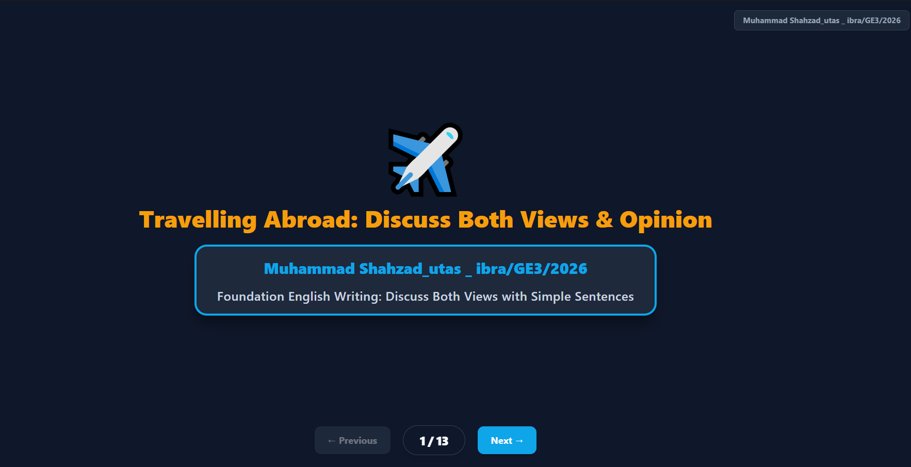
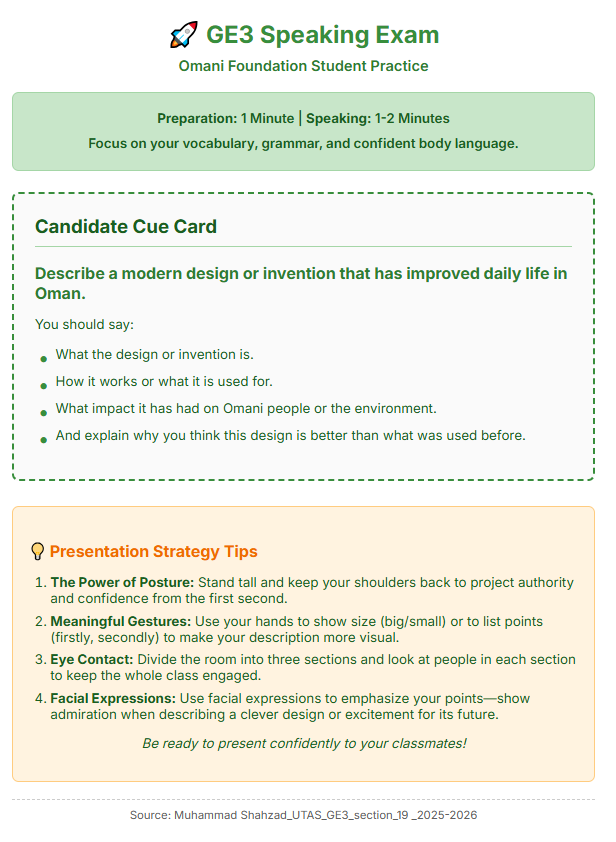
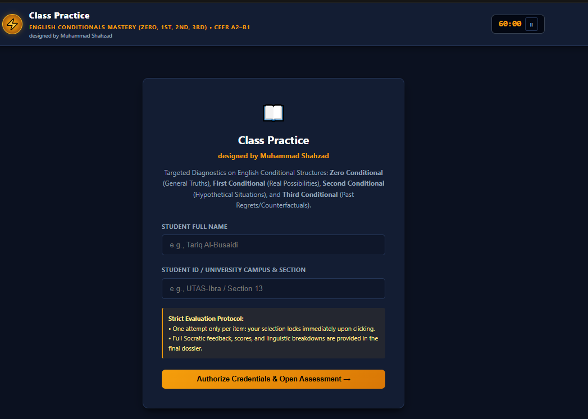
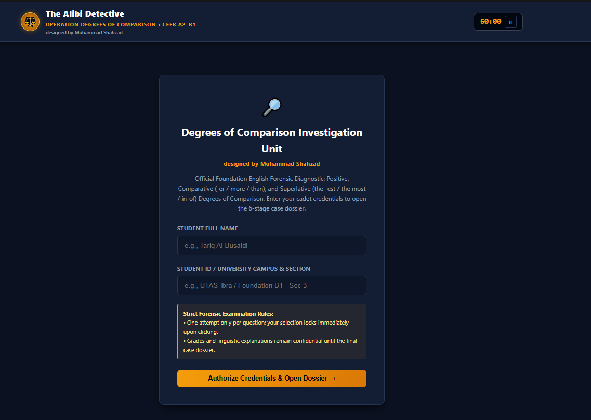
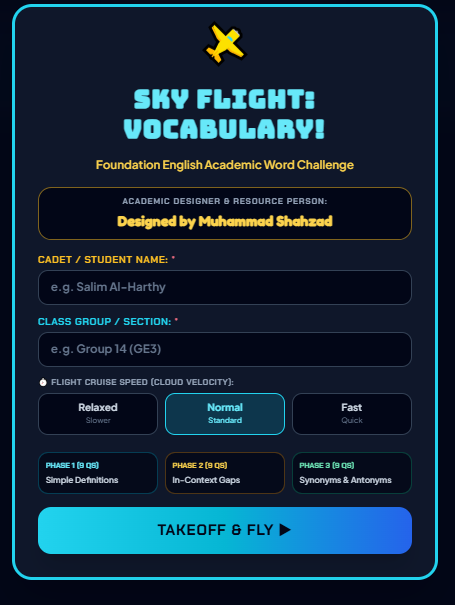

# Interactive & AI-Supported Learning Design

### Muhammad Shahzad
**University English Lecturer | Interactive Learning Designer | AI-Supported Education**

Higher Education | English Language Teaching | Interactive Learning | Gamification | AI-Supported Assessment

---

## About Me

I am a university English lecturer and interactive learning designer with 25+ years of experience in higher education and EFL teaching. My current work focuses on designing interactive, gamified, and AI-supported learning activities that address practical classroom needs.

I combine classroom experience with emerging technologies to develop learning interfaces, digital activities, formative assessment tools, and AI-supported feedback workflows. My approach is teacher-led: technology is used to support pedagogical decisions, learner practice, feedback, and engagement rather than to replace the teacher.

My portfolio demonstrates practical work in interactive learning design, gamification, AI-supported assessment, and technology-enhanced EFL teaching. I am particularly interested in how teachers can use AI and adaptive technologies to create more responsive and meaningful learning experiences in higher education..

---

## Featured Projects

The following projects represent my work in interactive learning design, gamification, writing development, and AI-supported assessment.

### What I Bring

- **25+ years of higher-education and EFL teaching experience**, providing a strong understanding of learner needs, classroom constraints, assessment, and teacher decision-making.
- **Practical learning-design experience**, demonstrated through interactive HTML activities, games, guided writing tasks, speaking activities, and digital learning interfaces.
- **AI-supported educational practice**, including multimodal writing analysis, diagnostic feedback, and AI-assisted learning workflows.
- **Teacher-led technology integration**, with technology selected and designed around pedagogical goals rather than technology alone.
- **A developing research focus on Human–AI learning**, particularly adaptive interactive activities, teacher expertise, AI-supported assessment, and gamification in higher education.

### 1. AI Diagnostic Writing Evaluator

**AI-Supported Assessment | IELTS/EFL Writing**
**Teacher-designed workflow:** The evaluator reflects a classroom assessment process developed around students' handwritten writing. It uses AI-supported analysis to identify writing difficulties, evaluate responses against assessment criteria, and provide diagnostic feedback to guide further learning. The teacher remains responsible for interpreting the feedback and making pedagogical decisions.
A prototype designed to analyse handwritten student writing using multimodal AI. The assessment workflow combines handwritten-response analysis, rubric-based evaluation, error diagnosis, and targeted formative feedback.

**Design focus:** AI-supported assessment, writing diagnosis, formative feedback, and teacher decision-making.

**Technology environment:** Google Gemini. The full AI analysis currently depends on the Gemini environment; the GitHub Pages link provides the project interface rather than an independently functioning AI application.

- [Project Interface](https://shahzad007-crypto.github.io/Marking-assessment/)
- [Source Repository](https://github.com/shahzad007-crypto/Marking-assessment)

*Note: This is a prototype. A privacy-safe demonstration version should be prepared before public professional presentation. Do not use the current interface publicly if it exposes identifiable student or assessment information.*

### 2. Tools Students Use – Survey Construction Studio

**Collaborative Learning | Language Production**

An interactive learning activity in which students work with survey-related language and construct questions through guided tasks. It encourages active participation, structured language production, and collaborative learning.

**Design focus:** Learner engagement, collaborative tasks, guided sentence construction, and activity-based learning.

- [Project Interface](https://shahzad007-crypto.github.io/Tools-students-use-/)
- [Source Repository](https://github.com/shahzad007-crypto/Tools-students-use-)

### 3. Vocabulary Tri-Arena

**Classroom implementation:** The interface is designed for teacher customization and live classroom use. Student names, session details, and other class-specific information can be configured by the teacher for each class.
**Gamified Learning | Vocabulary and Listening**

A multi-stage vocabulary learning activity combining listening, quizzes, sentence construction, and interactive challenges. Game elements encourage participation and provide opportunities for repeated practice.

**Design focus:** Gamification, vocabulary development, listening practice, immediate feedback, and learner engagement.

- [Project Interface](https://shahzad007-crypto.github.io/vocab-6-A-listening-QTT/)
- [Source Repository](https://github.com/shahzad007-crypto/vocab-6-A-listening-QTT)

### 4. Tenses Game – The Alibi Detective

**Gamified Grammar Learning | Interactive Assessment**

A narrative-based grammar activity in which learners work through a sequence of challenges involving English tenses. The detective theme provides a context for grammar practice, feedback, and assessment.

**Design focus:** Game-based learning, grammar practice, staged challenges, and diagnostic feedback.

- [Project Interface](https://shahzad007-crypto.github.io/tenses-gameperfect/)
- [Source Repository](https://github.com/shahzad007-crypto/tenses-gameperfect)

### 5. Sentence-by-Sentence Bar Chart

**Scaffolded Writing | IELTS Academic Writing Task 1**

An interactive writing activity that guides learners through the process of constructing a bar-chart description sentence by sentence. It breaks a demanding writing task into manageable stages.

**Design focus:** Writing scaffolding, academic language, sentence construction, and gradual development of independent writing.

- [Project Interface](https://shahzad007-crypto.github.io/sentence-by-sentence-bar-chart-/)
- [Source Repository](https://github.com/shahzad007-crypto/sentence-by-sentence-bar-chart-)

### 6. IELTS Opinion Essay

An interactive learning resource designed to support learners in developing opinion essays through structured guidance and writing practice.

**Design focus:** Essay organisation, argument development, language support, and scaffolded writing.

- [Project Interface](https://shahzad007-crypto.github.io/IELTS-opinion-essay-/)
- [Source Repository](https://github.com/shahzad007-crypto/IELTS-opinion-essay-)

### 7. IELTS Cue Card Speaking

**Speaking Development | Guided Language Production**

An interactive speaking-practice resource built around IELTS cue-card tasks. It supports learners in organising ideas and developing spoken responses through guided practice.

**Design focus:** Speaking fluency, idea development, structured responses, and independent practice.

- [Project Interface](https://shahzad007-crypto.github.io/IELTS-cue-card-speaking-/)
- [Source Repository](https://github.com/shahzad007-crypto/IELTS-cue-card-speaking-)

### 8. Conditionals Gamified

**Gamified Grammar | Formative Assessment**

An interactive grammar activity that uses game-oriented practice to help learners understand and apply English conditional structures.

**Design focus:** Grammar learning, interactive practice, feedback, and learner progress.

- [Project Interface](https://shahzad007-crypto.github.io/conditionals-gamified-/)
- [Source Repository](https://github.com/shahzad007-crypto/conditionals-gamified-)

### 9. Gamified Adjectives – The Alibi Detective

**Vocabulary and Grammar | Narrative-Based Learning**

A detective-themed language activity that uses staged challenges to engage learners in adjective-related practice.

**Design focus:** Gamified language learning, vocabulary development, interactive challenges, and feedback.

- [Project Interface](https://shahzad007-crypto.github.io/gamified-adjectives/)
- [Source Repository](https://github.com/shahzad007-crypto/gamified-adjectives)

### 10. Aeroplane Vocabulary Game

**Gamified Vocabulary | Interactive Practice**

A game-based vocabulary activity that places language practice within an aviation-themed experience. It aims to make vocabulary learning more engaging through interactive tasks.

**Design focus:** Vocabulary development, game-based practice, learner motivation, and digital interaction.

- [Project Interface](https://shahzad007-crypto.github.io/aeroplane-vocan-unit-5/)
- [Source Repository](https://github.com/shahzad007-crypto/aeroplane-vocan-unit-5)

---

## Research & Design Interests

My practical teaching and design work has encouraged me to explore the following areas

- **Human–AI learning design:** exploring how teachers can use AI to support interactive and adaptive learning activities while retaining pedagogical control.
- **Interactive EFL learning:** designing technology-supported activities that move learners from controlled practice toward independent language production.
- **AI-supported formative assessment:** using AI to analyse learner writing and provide diagnostic feedback that can support teacher decision-making.
- **Gamification and learning activities:** investigating how game mechanics, interaction, feedback, and classroom activity design can support learner engagement and practice.
- **Teacher expertise and AI:** exploring how teachers' pedagogical knowledge can be represented and used in AI-supported learning environments.
- **Adaptive learning:** examining how learner performance, activity characteristics, and teacher responses can inform more responsive learning experiences in higher education.
---

## Design Approach

My work follows several guiding principles:

1. **Pedagogy before technology:** Learning objectives and learner needs guide the design of each activity.
2. **Active learner participation:** Activities should require learners to think, respond, construct, practise, and reflect.
3. **Scaffolded learning:** Complex tasks can be divided into manageable stages that support gradual development.
4. **Meaningful feedback:** Feedback should help learners understand errors and improve their performance.
5. **Teacher agency:** AI and digital tools should support teachers' decisions, not replace professional judgement.

---

## Tools & Technologies

My project development and experimentation have involved:

- HTML, CSS, and JavaScript-based learning interfaces
- GitHub and GitHub Pages
- Google Gemini and generative AI tools
- Interactive presentations and digital worksheets
- Automated checking and feedback activities
- AI-assisted design and prototyping

---

## Professional Interests

I am interested in opportunities and collaborations related to:

- Instructional Design and Learning Experience Design
- Educational Technology in Higher Education
- AI in Education
- Digital Language Learning
- Interactive and Gamified Learning
- AI-Supported Assessment and Feedback
- Human–AI Adaptive Learning Research

---

## Contact

**Muhammad Shahzad**

University English Language Lecturer | Interactive Learning Designer

[GitHub Profile](https://github.com/shahzad007-crypto)

[Explore My Digital Learning Projects](https://github.com/shahzad007-crypto?tab=repositories)

---

*This portfolio presents selected educational design projects and ongoing experiments. The projects are practical explorations informed by classroom teaching experience and an interest in improving higher education through thoughtful use of technology.*
